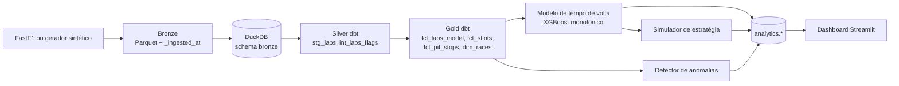
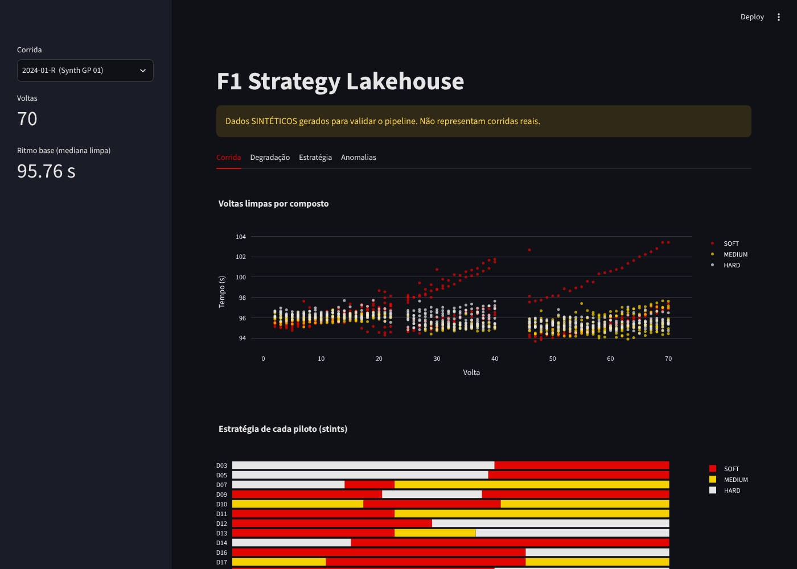
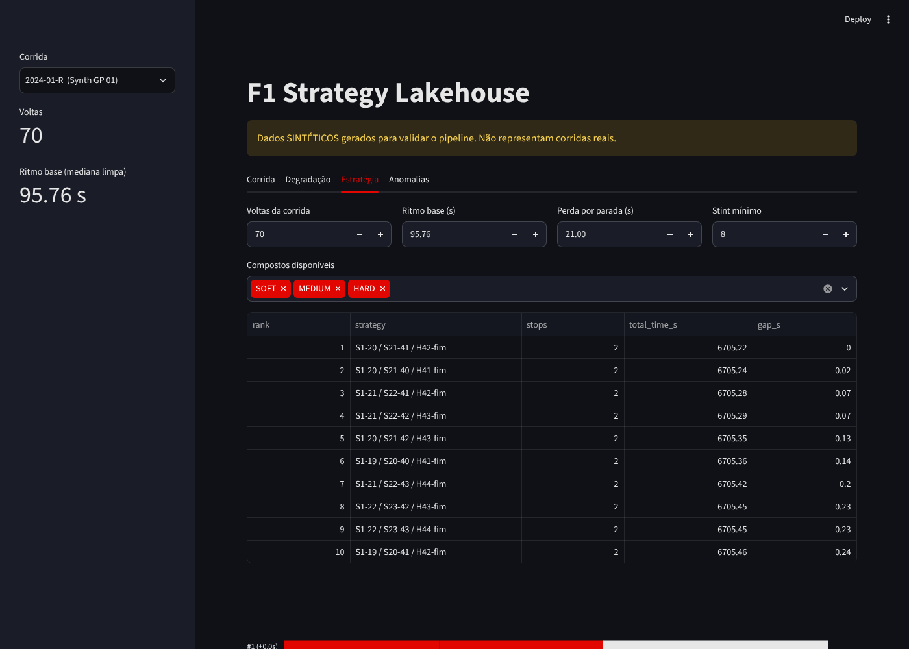
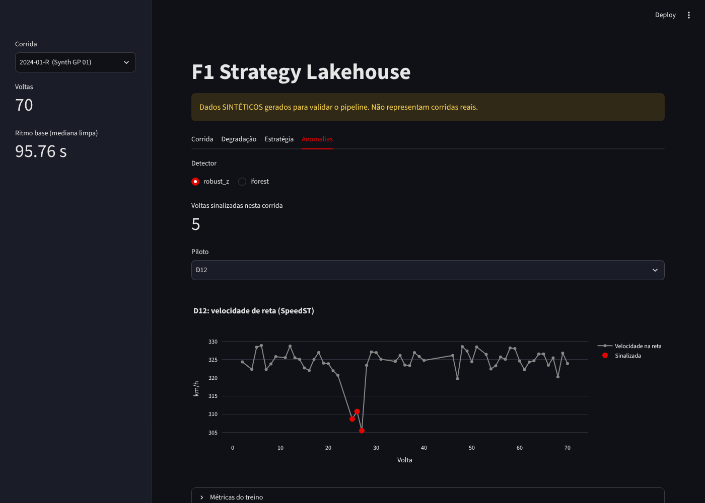

# F1 Strategy Lakehouse

Pipeline de engenharia de dados e machine learning para estratégia de corrida de Fórmula 1: voltas entram em camadas Bronze, Silver e Gold (DuckDB + dbt), alimentam um modelo de tempo de volta, um simulador de pit stop e um detector de anomalias nas velocidades de reta, e tudo aparece em um dashboard Streamlit.

> **Leia isto primeiro.** Os resultados abaixo vêm de **corridas sintéticas com verdade conhecida**, porque o ambiente onde o projeto foi construído não alcança os servidores da F1. Eles provam que o pipeline e o modelo **recuperam os parâmetros usados para gerar os dados**. Não provam desempenho em corridas reais. O conector de dados reais (FastF1) está escrito, mas **não foi executado contra a rede**. Detalhes em [Validado e não validado](#validado-e-não-validado).

## Arquitetura



| Camada | O que faz |
|---|---|
| Bronze | Grava o que chegou, no esquema do `fastf1.core.Laps`, com tempos em segundos e `_ingested_at`. Falha cedo se o contrato mudar ou a chave `(corrida, piloto, volta)` duplicar. |
| Silver | `stg_laps` padroniza nomes e tipos. `int_laps_flags` marca voltas de entrada/saída dos boxes, status de pista e `is_clean`. Nenhuma linha é descartada aqui. |
| Gold | `fct_laps_model` (só voltas limpas de pneu seco, alvo normalizado pela mediana da corrida), `fct_stints`, `fct_pit_stops`, `dim_races`. |
| Análise | Modelo, simulador e detectores em Python; resultados publicados em `analytics.*` no mesmo DuckDB. |

Uma volta é **limpa** quando: não é a volta 1, tem tempo, não foi anulada, é precisa, o `TrackStatus` é exatamente `"1"` (sem amarela, safety car, VSC ou bandeira vermelha) e não é volta de entrada nem de saída dos boxes.

## O que cada parte faz

**Modelo de tempo de volta.** Prevê quanto uma volta se afasta do ritmo base da corrida, a partir da idade do pneu, do número da volta (proxy de combustível) e do composto. É um XGBoost com **restrições monotônicas** (mais idade nunca deixa a volta mais rápida; menos combustível nunca deixa mais lenta), comparado com uma regressão linear de baseline. Árvores não extrapolam, então o modelo guarda a idade máxima vista por composto (`max_age`).

**Simulador de estratégia.** Enumera todas as estratégias de 1 e 2 paradas (todas as voltas, todas as sequências de compostos), com pelo menos 2 compostos, stint mínimo configurável e **nenhum stint além da idade que o modelo conhece**. A perda por parada é estimada dos dados: volta de entrada + volta de saída menos o que o modelo diz que seriam sem parar.

**Detecção de anomalias.** Procura quedas sustentadas nas velocidades de reta (`SpeedI1`, `SpeedI2`, `SpeedFL`, `SpeedST`) por piloto, como sinal de problema de potência. Compara um z-score robusto (mediana e MAD) com um Isolation Forest. Não usei LSTM de propósito: sem volume nem rótulos reais, um detector simples e explicável é o ponto de partida honesto.

## Resultados (dados sintéticos)

Protocolo em `f1lab/evaluate.py`; números completos em [`docs/evaluation.json`](docs/evaluation.json). Os parâmetros dos detectores foram escolhidos em uma temporada de **ajuste** e avaliados em 5 temporadas de **teste** com sementes diferentes, mais 2 temporadas **sem nenhuma anomalia** para medir alarme falso.

**Modelo (validação deixando uma corrida inteira de fora, RMSE em segundos)**

| | RMSE |
|---|---|
| Prever a média | 1,15 |
| Regressão linear (baseline) | 0,45 |
| XGBoost monotônico | **0,42** |

O ruído irredutível dos dados é da ordem de 0,3 a 0,4 s, então o ganho do XGBoost sobre o baseline no erro é modesto. Onde ele realmente se separa é no **formato da degradação**:

| Erro médio da curva de degradação vs. a verdade (s) | XGBoost | Linear |
|---|---|---|
| SOFT | 0,08 | 0,75 |
| MEDIUM | 0,05 | 0,27 |
| HARD | 0,09 | 0,17 |

Efeito do combustível entre as voltas 10 e 40: estimado −1,03 s, verdade −0,96 s. Perda por parada: estimada 21,4 s (mediana), verdade 21,2 s.

**Simulador.** Arrependimento = tempo que a estratégia escolhida pelo modelo perde, medido com a física verdadeira, contra a melhor estratégia possível. Em corridas de 52 a 66 voltas ficou entre 0 e 0,12 s; **na de 70 voltas chegou a 1,6 s** (de ~6.300 s de corrida), porque faltam dados de pneu muito velho. Um modelo aleatório perde no mínimo 11,8 s.

**Anomalias (5 temporadas de teste, 351 voltas com falha injetada)**

| Detector | Precisão | Revocação | F1 | Alarmes falsos em 14.361 voltas sem anomalia |
|---|---|---|---|---|
| z-score robusto | 1,00 | 0,92 | 0,955 | **2** |
| Isolation Forest | 0,98 | 0,93 | 0,953 | 67 |

Os dois empatam em F1, mas o Isolation Forest, por construção, sempre marca uma fração fixa das voltas; para alerta operacional o detector simples é melhor. O z-score erra cerca de 1 alarme falso por temporada de 8 corridas.

## Como foi testado

**50 testes** (pytest), incluindo o `dbt build` real e o dashboard rodando em modo headless:

- O Gold é **recalculado de forma independente em pandas** e comparado com o do dbt (contagem de voltas, mediana por corrida, pares de pit stop).
- O simulador tem um **oráculo** (a física verdadeira) para medir arrependimento, e um **controle negativo** (modelo aleatório) para provar que o teste distingue um modelo bom de um ruim.
- O dbt tem que **falhar** quando os dados são corrompidos (teste com chave duplicada).
- **Testes de mutação**: quebrei o código de propósito de 5 jeitos e conferi se a suíte reclama. Os 5 foram detectados.

| Mutação | Resultado |
|---|---|
| dbt deixa safety car passar como volta limpa | detectada |
| dbt deixa volta de box passar como volta limpa | detectada |
| modelo sem restrição monotônica | detectada |
| simulador sem a regra de 2 compostos | detectada |
| perda por parada ignorando a volta de saída | detectada |

A primeira rodada de mutação **achou uma falha nos meus testes**: a mutação do safety car passava em tudo, porque no gerador a coluna `IsAccurate` já era falsa nessas voltas e a regra do dbt nunca era exercitada. Corrigi o gerador para que cada regra de limpeza tenha que funcionar sozinha.

## Como rodar

Dois ambientes, porque o dbt e o Streamlit têm dependências de protobuf incompatíveis.

```bash
python -m venv .venv      && .venv/bin/pip install -r requirements-dev.txt
python -m venv .venv-dbt  && .venv-dbt/bin/pip install -r requirements-dbt.txt
export DBT_BIN=$PWD/.venv-dbt/bin/dbt

.venv/bin/python -m f1lab.pipeline all --races 8 --seed 7   # sintético -> bronze -> dbt -> treino
.venv/bin/streamlit run dashboard/app.py
.venv/bin/python -m pytest -q
```

No Windows, os executáveis ficam em `.venv\Scripts\` (`python.exe`, `streamlit.exe`, `dbt.exe`) e a variável é `$env:DBT_BIN`. **Os comandos de Windows não foram testados**; tudo foi executado em Linux.

**Com dados reais** (rode na sua máquina, com internet):

```bash
.venv/bin/python -m f1lab.fetch_fastf1 --year 2024 --rounds 1 2 3 --out data/bronze
.venv/bin/python -m f1lab.pipeline build
.venv/bin/python -m f1lab.pipeline train
```

## Validado e não validado

**Validado (executado)**
- Pipeline completo em dados sintéticos: Bronze, DuckDB, `dbt build` (22 de 22), treino, publicação, dashboard.
- 50 testes, `ruff` limpo, 5 mutações detectadas, dashboard renderizado em navegador real nas 4 abas.
- Os nomes das colunas do contrato foram conferidos no código-fonte do FastF1 3.9.2 instalado, e a conversão `laps_to_bronze` é testada com um DataFrame no formato do FastF1 (timedelta, NaT).

**Não validado**
- **Nenhuma execução com dados reais.** `fetch_race` (a chamada de rede) nunca rodou. Suposições a conferir: `PitInTime` na volta de entrada e `PitOutTime` na de saída; `IsAccurate` e `TrackStatus` com o significado documentado; o nome do circuito vindo de `session.event["Location"]`.
- **O modelo nunca viu uma corrida real.** O gerador e o modelo compartilham a mesma estrutura (efeito aditivo de idade e combustível), então os números acima são otimistas. Em corridas reais há tráfego, evolução da pista, clima, diferença entre pilotos e combustível que não é linear.
- **O simulador não modela** tráfego, ultrapassagens, safety car, clima nem temperatura. Compara estratégias entre si em pista livre; não prevê tempo de corrida.
- **As anomalias injetadas são o caso fácil**: queda constante nas quatro velocidades. Falhas reais são mais sutis. Não foi testado com falha real.
- Comandos de Windows, o workflow do GitHub Actions (só a sintaxe foi conferida) e qualquer execução em nuvem.

## Limitações assumidas

- DuckDB local. A versão em nuvem (Azure com ADLS e Databricks) é o próximo passo e **não existe ainda**.
- O alvo é normalizado pela mediana da corrida, então o simulador precisa de um ritmo base informado (o dashboard usa a mediana das voltas limpas da própria corrida).
- Só pneu seco (SOFT, MEDIUM, HARD); voltas de chuva ficam fora do modelo.

## Estrutura

```
f1lab/         schema, synth (gerador com verdade conhecida), bronze, fetch_fastf1, model, strategy, anomaly, pipeline, evaluate
dbt_project/   models (staging, intermediate, marts) + testes singulares
dashboard/     app.py (Streamlit)
tests/         50 testes
docs/          evaluation.json e capturas do dashboard
```

## Dashboard





**Stack:** Python, DuckDB, dbt, XGBoost, scikit-learn, Streamlit, Plotly, FastF1, pytest, GitHub Actions.
