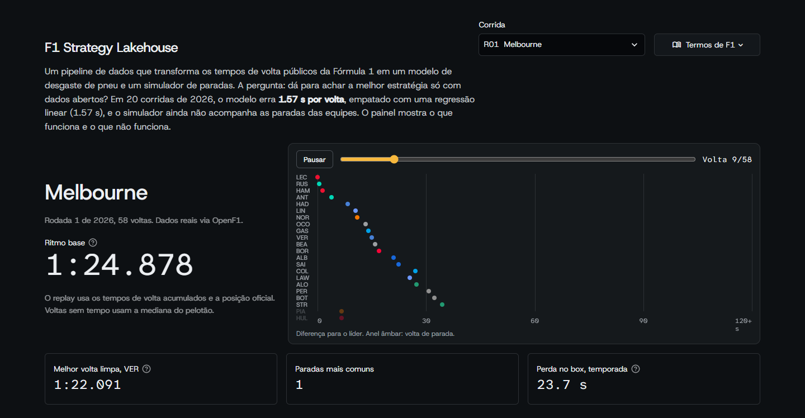
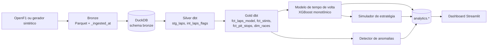
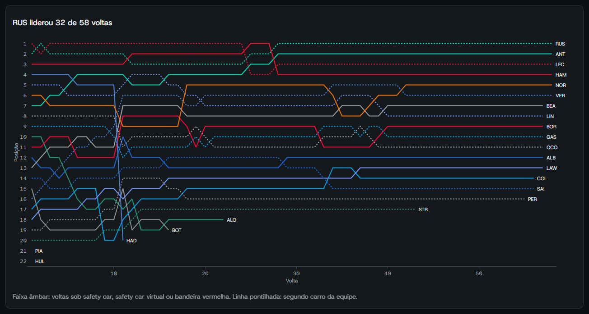
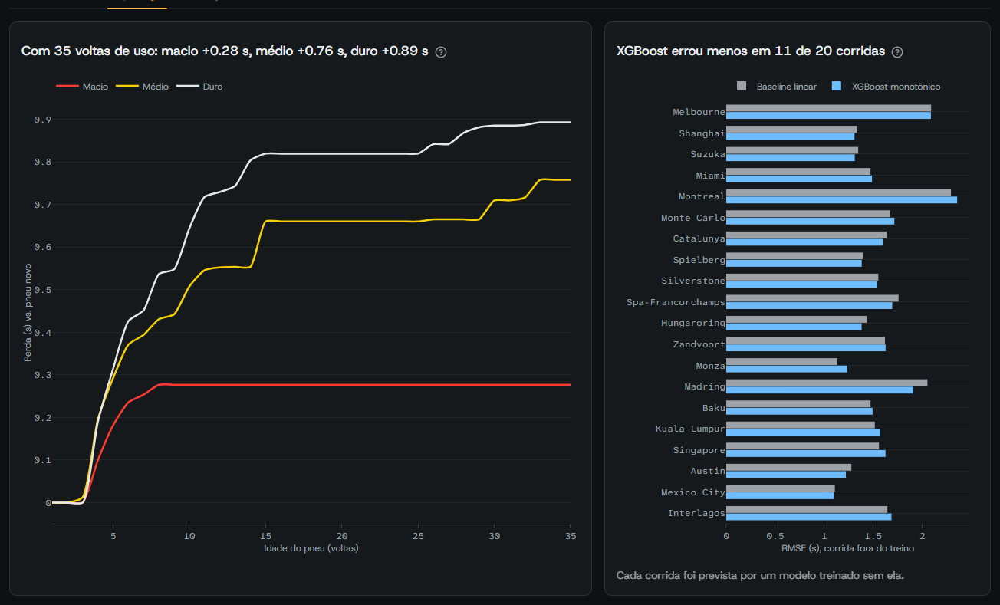
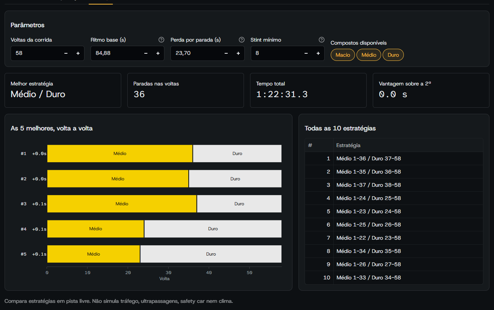

# F1 Strategy Lakehouse

Pipeline de engenharia de dados e machine learning para estratégia de corrida de Fórmula 1: voltas entram em camadas Bronze, Silver e Gold (DuckDB + dbt), alimentam um modelo de tempo de volta, um simulador de pit stop e um detector de anomalias nas velocidades de reta, e tudo aparece em um dashboard Streamlit.

> **Leia isto primeiro.** O projeto roda com **as 20 corridas de 2026 já disputadas**, baixadas pela OpenF1. Com dados reais, **o XGBoost empata com a regressão linear**, e o simulador tem uma limitação conhecida. Os dois resultados estão em [Resultados com dados reais](#resultados-com-dados-reais), com a causa de cada um. A seção seguinte mostra a validação com dados sintéticos, onde a verdade é conhecida.



## Arquitetura



| Camada | O que faz |
|---|---|
| Bronze | Grava o que chegou, no esquema do `fastf1.core.Laps`, com tempos em segundos e `_ingested_at`. Falha cedo se o contrato mudar ou a chave `(corrida, piloto, volta)` duplicar. |
| Silver | `stg_laps` padroniza nomes e tipos. `int_laps_flags` marca voltas de entrada/saída dos boxes, status de pista e `is_clean`. Nenhuma linha é descartada aqui. |
| Gold | `fct_laps_model` (só voltas limpas de pneu seco, alvo normalizado pela mediana da corrida), `fct_stints`, `fct_pit_stops`, `dim_races`. |
| Análise | Modelo, simulador e detectores em Python; resultados publicados em `analytics.*` no mesmo DuckDB. |

Uma volta é **limpa** quando: não é a volta 1, tem tempo, não foi anulada, é precisa, o `TrackStatus` é exatamente `"1"` (sem amarela, safety car, VSC ou bandeira vermelha) e não é volta de entrada nem de saída dos boxes. Além disso, a volta inteira sai quando a mediana do pelotão nela passa 5% do ritmo base da corrida: é o caso de uma relargada que chega com `TrackStatus` igual a `"1"`. E sai a volta que, sozinha, fica mais de 30% acima do ritmo base (rodada, dano, carro parado), porque isso é incidente e não desgaste de pneu. As duas medianas usam só pneu seco.

## O que cada parte faz

**Modelo de tempo de volta.** Prevê quanto uma volta se afasta do ritmo base da corrida, a partir da idade do pneu, do número da volta (proxy de combustível) e do composto. É um XGBoost com **restrições monotônicas** (mais idade nunca deixa a volta mais rápida; menos combustível nunca deixa mais lenta), comparado com uma regressão linear de baseline. Árvores não extrapolam, então o modelo guarda a idade máxima vista por composto (`max_age`).

**Simulador de estratégia.** Enumera todas as estratégias de 1 e 2 paradas (todas as voltas, todas as sequências de compostos), com pelo menos 2 compostos, stint mínimo configurável e **nenhum stint além da idade que o modelo conhece**. A perda por parada é estimada dos dados: volta de entrada + volta de saída menos o que o modelo diz que seriam sem parar.

**Detecção de anomalias.** Procura quedas sustentadas nas velocidades de reta (`SpeedI1`, `SpeedI2`, `SpeedFL`, `SpeedST`) por piloto, como sinal de problema de potência. Compara um z-score robusto (mediana e MAD) com um Isolation Forest. Não usei LSTM de propósito: sem volume nem rótulos reais, um detector simples e explicável é o ponto de partida honesto.

## Resultados com dados reais

Temporada 2026, as 20 corridas já disputadas (Melbourne a Interlagos), baixadas pela OpenF1: 23.626 voltas na Bronze e 17.947 voltas limpas de pneu seco no Gold. RMSE em segundos, deixando uma corrida inteira de fora do treino:

| Corrida | Prever a média | Regressão linear | XGBoost monotônico |
|---|---|---|---|
| Melbourne | 2,22 | 2,09 | 2,09 |
| Shanghai | 1,53 | 1,33 | **1,31** |
| Suzuka | 1,59 | 1,35 | **1,31** |
| Miami | 1,51 | **1,47** | 1,49 |
| Montreal | 2,29 | **2,29** | 2,36 |
| Monte Carlo | 1,72 | **1,67** | 1,72 |
| Catalunya | 1,82 | 1,64 | **1,60** |
| Spielberg | 1,51 | 1,40 | **1,38** |
| Silverstone | 1,68 | 1,55 | **1,54** |
| Spa-Francorchamps | 1,87 | 1,76 | **1,69** |
| Hungaroring | 1,66 | 1,44 | **1,38** |
| Zandvoort | 1,75 | **1,62** | 1,63 |
| Monza | 1,22 | **1,13** | 1,24 |
| Madring | 2,27 | 2,05 | **1,91** |
| Baku | 1,61 | **1,47** | 1,49 |
| Kuala Lumpur | 1,62 | **1,52** | 1,57 |
| Singapore | 1,68 | **1,56** | 1,63 |
| Austin | 1,50 | 1,28 | **1,22** |
| Mexico City | 1,09 | 1,11 | 1,10 |
| Interlagos | 1,81 | **1,64** | 1,69 |
| **Média** | 1,70 | 1,57 | 1,57 |

Os dois modelos **empatam** no erro médio, e o XGBoost é melhor em 11 das 20 corridas. Com dados reais ele não mostra a vantagem que tinha nos dados sintéticos, e a regressão linear continua sendo um baseline difícil de bater. O mesmo empate apareceu antes com 6 corridas de 2024 (0,99 contra 1,00).

**Um erro encontrado e corrigido em 2024: 11 voltas mal classificadas.** Em Suzuka 2024 houve bandeira vermelha na volta 1. A volta 3, da relargada, levou cerca de 149 s, mas chegou com `TrackStatus` igual a `"1"` e passou como volta limpa. São 11 voltas em 5.107, com até 62 s de erro, e o XGBoost aprende esse padrão como efeito de pneu novo. Antes da correção, o RMSE médio era 2,40 (XGBoost) contra 1,83 (linear), e o XGBoost perdia em 5 das 6 corridas. A regra nova no `int_laps_flags` descarta a volta inteira quando a mediana do pelotão fica mais de 5% acima do ritmo base. Um teste simula uma relargada nos dados sintéticos e confere que a volta sai do Gold; com a regra desligada, ele falha. Em 2026 a regra marcou 28 voltas em 9 corridas.

**Outro, encontrado em 2026: uma volta de 1.168 s passou como limpa.** A OpenF1 não publica o `IsAccurate` do FastF1, que descartava esse tipo de volta. Em Melbourne, um carro parou e voltou à pista; a volta tinha pista livre e entrou no modelo. A regra dos 30% (a volta sozinha, acima do ritmo base) tira esses casos: 4 voltas em 2026 que passavam por todas as outras regras. Com ela, o RMSE médio caiu de 3,43 para 1,57.

**Limitação do simulador.** Com dados reais, ele recomenda sempre Médio e depois Duro. A primeira parada cai em dois grupos (voltas 16 a 24 ou 36 e 37), e não acompanha o que as equipes fizeram: a mediana real da primeira parada variou entre as voltas 14 e 46. A causa provável é que, dentro de um stint, idade do pneu e consumo de combustível sobem juntos e o modelo não consegue separar os dois; a curva de degradação fica quase plana.

## Resultados com dados sintéticos

Protocolo em `f1lab/evaluate.py`; números completos em [`docs/evaluation.json`](docs/evaluation.json). Os parâmetros dos detectores foram escolhidos em uma temporada de **ajuste** e avaliados em 5 temporadas de **teste** com sementes diferentes, mais 2 temporadas **sem nenhuma anomalia** para medir alarme falso.

**Modelo (validação deixando uma corrida inteira de fora, RMSE em segundos)**

| | RMSE |
|---|---|
| Prever a média | 1,15 |
| Regressão linear (baseline) | 0,45 |
| XGBoost monotônico | **0,42** |

O ruído irredutível dos dados é da ordem de 0,3 a 0,4 s, então o ganho do XGBoost sobre o baseline no erro é modesto. Onde ele realmente se separa é no **formato da degradação**:

| Erro médio da curva de degradação vs. a verdade (s) | XGBoost | Linear |
|---|---|---|
| SOFT | 0,08 | 0,75 |
| MEDIUM | 0,05 | 0,27 |
| HARD | 0,09 | 0,17 |

Efeito do combustível entre as voltas 10 e 40: estimado −1,03 s, verdade −0,96 s. Perda por parada: estimada 21,4 s (mediana), verdade 21,2 s.

**Simulador.** Arrependimento = tempo que a estratégia escolhida pelo modelo perde, medido com a física verdadeira, contra a melhor estratégia possível. Em corridas de 52 a 66 voltas ficou entre 0 e 0,12 s; **na de 70 voltas chegou a 1,6 s** (de ~6.300 s de corrida), porque faltam dados de pneu muito velho. Um modelo aleatório perde no mínimo 11,8 s.

**Anomalias (5 temporadas de teste, 351 voltas com falha injetada)**

| Detector | Precisão | Revocação | F1 | Alarmes falsos em 14.361 voltas sem anomalia |
|---|---|---|---|---|
| z-score robusto | 1,00 | 0,92 | 0,955 | **2** |
| Isolation Forest | 0,98 | 0,93 | 0,953 | 67 |

Os dois empatam em F1, mas o Isolation Forest, por construção, sempre marca uma fração fixa das voltas; para alerta operacional o detector simples é melhor. O z-score erra cerca de 1 alarme falso por temporada de 8 corridas.

## Como foi testado

**57 testes** (pytest), incluindo o `dbt build` real e o dashboard rodando em modo headless:

- O Gold é **recalculado de forma independente em pandas** e comparado com o do dbt (contagem de voltas, mediana por corrida, pares de pit stop).
- O simulador tem um **oráculo** (a física verdadeira) para medir arrependimento, e um **controle negativo** (modelo aleatório) para provar que o teste distingue um modelo bom de um ruim.
- O dbt tem que **falhar** quando os dados são corrompidos (teste com chave duplicada).
- **Testes de mutação**: quebrei o código de propósito de 5 jeitos e conferi se a suíte reclama. Os 5 foram detectados; depois acrescentei uma sexta, para a regra de relargada, também detectada.

| Mutação | Resultado |
|---|---|
| dbt deixa safety car passar como volta limpa | detectada |
| dbt deixa volta de box passar como volta limpa | detectada |
| modelo sem restrição monotônica | detectada |
| simulador sem a regra de 2 compostos | detectada |
| perda por parada ignorando a volta de saída | detectada |
| dbt sem a regra de volta lenta do pelotão (relargada) | detectada |

A primeira rodada de mutação **achou uma falha nos meus testes**: a mutação do safety car passava em tudo, porque no gerador a coluna `IsAccurate` já era falsa nessas voltas e a regra do dbt nunca era exercitada. Corrigi o gerador para que cada regra de limpeza tenha que funcionar sozinha.

## Como rodar

Dois ambientes, porque o dbt e o Streamlit têm dependências de protobuf incompatíveis.

```bash
python -m venv .venv      && .venv/bin/pip install -r requirements-dev.txt
python -m venv .venv-dbt  && .venv-dbt/bin/pip install -r requirements-dbt.txt
export DBT_BIN=$PWD/.venv-dbt/bin/dbt

.venv/bin/python -m f1lab.pipeline all --races 8 --seed 7   # sintético -> bronze -> dbt -> treino
.venv/bin/streamlit run dashboard/app.py
.venv/bin/python -m pytest -q
```

No Windows, o `rodar.ps1` faz tudo: cria os ambientes, baixa as corridas reais, roda o dbt, treina e abre o dashboard (`.\rodar.ps1`, ou `.\rodar.ps1 -Sintetico` sem internet).

**Com dados reais** (rode na sua máquina, com internet). A fonte é a [OpenF1](https://openf1.org), que não pede login: desde novembro de 2026 o FastF1 exige uma conta da Fórmula 1 até para os tempos de volta. As respostas cruas da API ficam em `data/raw/openf1/`, e reprocessar não precisa de rede.

```bash
.venv/bin/python -m f1lab.fetch_openf1 --year 2026 --rounds 1 2 3 --out data/bronze
.venv/bin/python -m f1lab.pipeline build
.venv/bin/python -m f1lab.pipeline train
```

## Validado e não validado

**Validado (executado)**
- Pipeline completo com as 6 corridas reais de 2024 baixadas pelo FastF1, no Windows, até o dashboard.
- Pipeline completo em dados sintéticos: Bronze, DuckDB, `dbt build` (22 de 22), treino, publicação, dashboard.
- **Troca de fonte de dados:** o conector da OpenF1 foi comparado volta a volta com o do FastF1 nas mesmas 6 corridas de 2024. Tempo de volta igual (diferença mediana de 0 ms), e posição, pneus, stints e entradas e saídas dos boxes batem em mais de 99% das voltas. O status da pista bate em 99,8% ou mais em 5 corridas; em Suzuka fica em 96%, porque a OpenF1 registra a volta da bandeira vermelha de outro jeito (essa volta já sai do modelo).
- Pipeline completo com as 20 corridas de 2026 já disputadas (até Interlagos), pela OpenF1.
- 57 testes, `ruff` limpo, 5 mutações detectadas, dashboard renderizado em navegador real nas 5 abas.
- Os nomes das colunas do contrato foram conferidos no código-fonte do FastF1 3.9.2 instalado, e a conversão `laps_to_bronze` é testada com um DataFrame no formato do FastF1 (timedelta, NaT).

**Não validado**
- **O limite de 5% foi escolhido olhando as 6 corridas de 2024.** Ele separa a relargada de Suzuka de todo o resto. Em 2026 ele rodou sem ajuste, mas ninguém conferiu volta a volta se as 28 voltas marcadas são todas neutralizadas.
- **O modelo não separa desgaste de combustível** em dados reais, e por isso a curva de degradação fica plana e o simulador sempre escolhe a parada mais tardia possível.
- **O simulador não modela** tráfego, ultrapassagens, safety car, clima nem temperatura. Compara estratégias entre si em pista livre; não prevê tempo de corrida.
- **As anomalias injetadas são o caso fácil**: queda constante nas quatro velocidades. Falhas reais são mais sutis. Não foi testado com falha real.
- O workflow do GitHub Actions (só a sintaxe foi conferida) e qualquer execução em nuvem.

## Limitações assumidas

- DuckDB local. A versão em nuvem (Azure com ADLS e Databricks) é o próximo passo e **não existe ainda**.
- O alvo é normalizado pela mediana da corrida, então o simulador precisa de um ritmo base informado (o dashboard usa a mediana das voltas limpas da própria corrida).
- Só pneu seco (SOFT, MEDIUM, HARD); voltas de chuva ficam fora do modelo.

## Estrutura

```
f1lab/         schema, synth (gerador com verdade conhecida), bronze, fetch_openf1, fetch_fastf1, model, strategy, anomaly, pipeline, evaluate
dbt_project/   models (staging, intermediate, marts) + testes singulares
dashboard/     app.py (Streamlit), replay.py (replay da corrida), car.py (desenho do carro)
tests/         57 testes
docs/          evaluation.json
```

## Dashboard

Cinco abas sobre a corrida escolhida: **Corrida** (posições volta a volta, stints e tempos), **Equipes** (ritmo por equipe), **Degradação** (curvas de pneu e erro do modelo por corrida), **Estratégia** (simulador) e **Anomalias** (quedas de velocidade de reta). No topo, um replay anima a diferença de cada piloto para o líder a partir dos tempos de volta reais.

Posições volta a volta, com o segundo carro de cada equipe pontilhado:



Curvas de degradação por composto e o erro de cada modelo com a corrida fora do treino:



O simulador de estratégia, com as 10 melhores combinações de pneus e paradas:



**Stack:** Python, DuckDB, dbt, XGBoost, scikit-learn, Streamlit, Plotly, OpenF1, FastF1, pytest, GitHub Actions.
